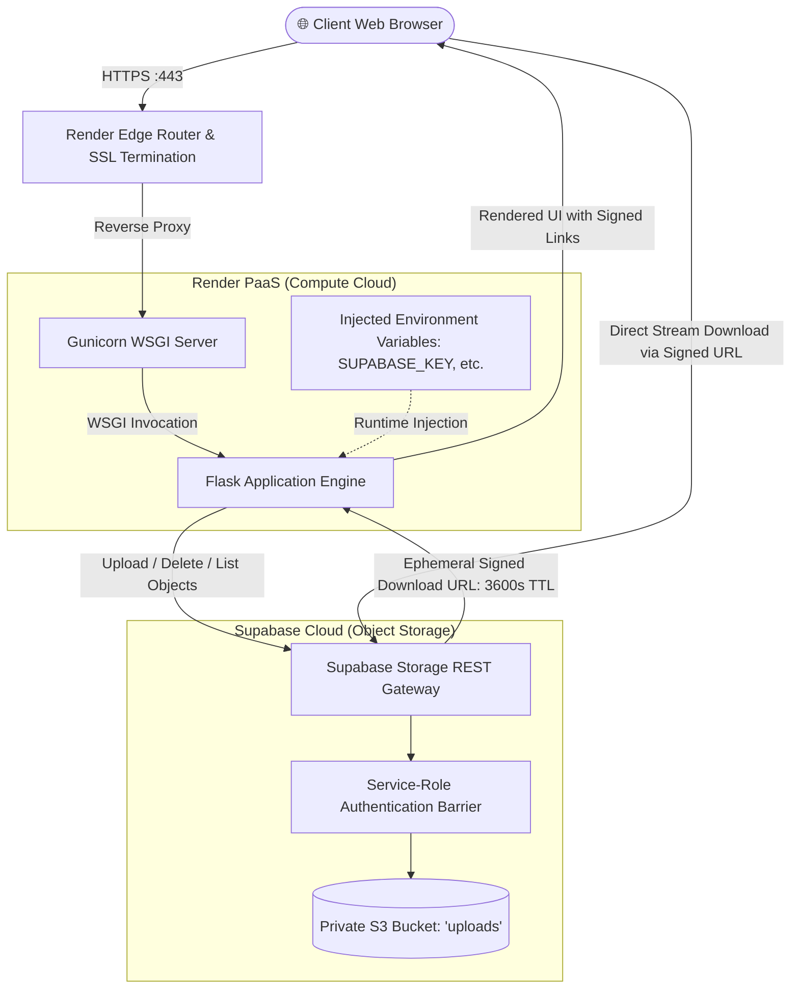

# ☁️ Cloud File Manager

> A modern, high-performance cloud storage web application built with Python, Flask, and Supabase Object Storage, deployed on Render.

[](https://cloud-file-manager-alml.onrender.com)
[](https://github.com/Chetanbavaliya123/cloud-file-manager)

[](https://python.org)
[](https://flask.palletsprojects.com/)
[](https://render.com)
[](https://supabase.com)
[](https://gunicorn.org/)
[](LICENSE)

---

## 🌐 Live Application

The production application is live and accessible over the internet:  
👉 **[https://cloud-file-manager-alml.onrender.com](https://cloud-file-manager-alml.onrender.com)**

---

## 📖 Overview

**Cloud File Manager** is a production-ready, cloud-native file storage application designed around modern multi-cloud principles. It completely decouples **Stateless Compute** from **Persistent Object Storage**:

- **Compute Tier**: Hosted on **Render** (Platform-as-a-Service) using a containerized Gunicorn WSGI web server running Python 3.12.
- **Storage Tier**: Persistent binary files are stored in an S3-compatible private bucket on **Supabase Storage**.
- **Access Control**: Bucket is private-by-default; files are downloaded directly from Supabase via on-demand, time-limited cryptographic signed URLs (3600-second expiration).
- **Zero Local Disk Dependency**: Container restarts or redeployments cause zero file loss because no files are persisted on the local container disk.

---

## 🏛️ System Architecture



---

## ✨ Key Features

- **Decoupled Cloud Architecture**: Stateless web service communicating with managed S3-compatible cloud object storage.
- **Private Bucket Security**: Bucket is configured strictly as `private`. Direct public access is rejected with `403 Forbidden`.
- **Time-Limited Signed URLs**: File downloads utilize HMAC-SHA256 signed URLs valid for **3600 seconds (1 hour)**, offloading download bandwidth directly to Supabase's high-speed CDN.
- **Upload Size Protection**: Strict **10 MB per-file upload limit** enforced at both application middleware level (`MAX_CONTENT_LENGTH`) and client-side dropzone validation.
- **Interactive Deletion Modal**: Clean, in-page confirmation modal with instant visual feedback, eliminating browser popup blockers and JavaScript escaping issues.
- **Health Check Probe**: Dedicated `/health` endpoint returning JSON status metadata for monitoring and uptime probes.
- **Modern Responsive UI**: Clean interface styled with emerald green accents, drag-and-drop file upload, file type icons, and live status bar.
- **Zero Stack-Trace Exposure**: Comprehensive error-handling boundaries intercept network and storage errors, presenting friendly alert banners without exposing internal stack traces.

---

## 🛠️ Tech Stack

| Component | Technology | Description |
| :--- | :--- | :--- |
| **Backend Framework** | [Flask 3.1](https://flask.palletsprojects.com/) | Lightweight WSGI web application framework |
| **WSGI Server** | [Gunicorn 26.x](https://gunicorn.org/) | Production-grade WSGI HTTP server for UNIX |
| **Storage SDK** | [supabase-py 2.x](https://github.com/supabase-community/supabase-py) | Official Python client library for Supabase Storage |
| **Compute Hosting** | [Render.com](https://render.com) | Fully managed Cloud PaaS with automated continuous deployment |
| **Object Storage** | [Supabase Storage](https://supabase.com/storage) | S3-compatible managed binary object storage |
| **Version Control & CI/CD**| [GitHub](https://github.com) | Central repository with automated webhook deployments to Render |
| **Automated Testing** | [Pytest 9.x](https://pytest.org) | Unit testing suite with mock doubles |

---

## 📡 API Endpoints

| Method | Endpoint | Description | Response |
| :---: | :--- | :--- | :--- |
| `GET` | `/` | Web dashboard: lists files, computes sizes, and builds signed download links | HTML (`index.html`) |
| `POST` | `/upload` | Uploads file to Supabase Storage with MIME detection and upsert enabled | `302 Redirect` to `/` |
| `GET` | `/delete/<path:name>` | Deletes the specified file from Supabase Storage | `302 Redirect` to `/` |
| `GET` | `/health` | Health check probe for uptime monitoring and deployment status | `200 OK` JSON |

---

## 🚀 Local Development Setup

### Prerequisites
- Python 3.10+ (Python 3.12 recommended)
- Git
- A Supabase account ([supabase.com](https://supabase.com))

### 1. Clone Repository
```bash
git clone https://github.com/Chetanbavaliya123/cloud-file-manager.git
cd cloud-file-manager
```

### 2. Setup Virtual Environment
```bash
# Windows
python -m venv .venv
.\.venv\Scripts\activate

# Linux / macOS
python3 -m venv .venv
source .venv/bin/activate
```

### 3. Install Dependencies
```bash
pip install -r requirements.txt
```

### 4. Configure Environment Variables
```bash
cp .env.example .env
```
Edit `.env` and fill in your Supabase credentials:
```env
SUPABASE_URL=https://your-project-id.supabase.co
SUPABASE_KEY=your-supabase-service-role-secret-key
BUCKET_NAME=uploads
PORT=5000
SECRET_KEY=your-custom-secret-key
```

### 5. Run Automated Tests
```bash
pytest -v
```

### 6. Launch Application
```bash
python app.py
```
Open **[http://localhost:5000](http://localhost:5000)** in your browser.

---

## ⚙️ Environment Variables Reference

| Variable | Description | Required | Example |
| :--- | :--- | :---: | :--- |
| `SUPABASE_URL` | Supabase Project API URL | **Yes** | `https://xyzproject.supabase.co` |
| `SUPABASE_KEY` | Supabase `service_role` secret key for server-side private bucket access | **Yes** | `eyJhbGciOi...` *(Secret)* |
| `BUCKET_NAME` | Supabase Storage bucket name | No | `uploads` (Default) |
| `PORT` | Local web server port | No | `5000` (Default) |
| `SECRET_KEY` | Flask session secret key | No | Auto-generated in production |
| `PYTHON_VERSION` | Python runtime version on Render | No | `3.12.3` |

---

## 📂 Project Structure

```text
cloud-file-manager/
├── .env.example          # Environment variables template
├── .gitignore            # Protects secrets (.env), caches, and virtualenvs
├── app.py                # Core Flask application and Supabase client
├── pytest.ini            # Pytest configuration
├── render.yaml           # Render Infrastructure-as-Code Blueprint
├── requirements.txt      # Production dependencies
├── templates/
│   └── index.html        # Responsive UI with emerald accents and custom modal
└── tests/
    └── test_app.py       # Automated unit tests with Supabase mocking
```

---

## 📄 License

This project is open-source and available under the [MIT License](LICENSE).
