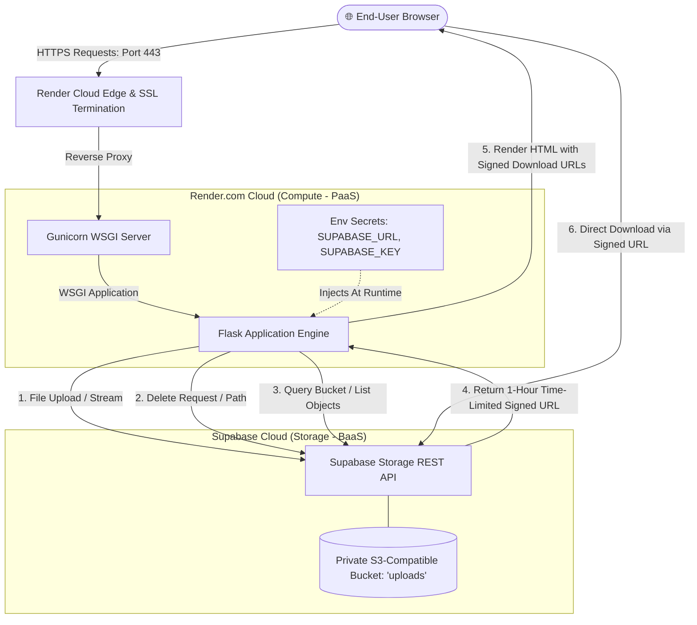

# ☁️ Cloud File Manager

> A production-ready, cloud-native file storage application developed for the **Cloud Computing (CC)** college assignment. Demonstrates multi-service cloud architecture integrating modern Compute (PaaS) and Managed Object Storage (BaaS) with zero infrastructure cost ($0).

[](https://python.org)
[](https://flask.palletsprojects.com/)
[](https://render.com)
[](https://supabase.com)
[](LICENSE)
[-brightgreen.svg)]()

---

## 🏛️ System Architecture

The application decouples presentation/application compute from persistent binary object storage:



---

## ✨ Features

- **Decoupled Cloud Architecture**: Web tier hosted on **Render** (Platform-as-a-Service), persistent object storage on **Supabase** (Storage as a Service).
- **Private Bucket Security**: Bucket is configured strictly as `private`. No public read access is enabled.
- **Time-Limited Signed URLs**: Files are downloaded via cryptographically signed URLs generated on-demand with a **3600-second (1-hour)** expiration window.
- **Resource Limits Enforcement**: Strict **10 MB per-file upload constraint** enforced at both application middleware level (`MAX_CONTENT_LENGTH`) and client-side dropzone validation.
- **Zero Stack Trace Exposure**: All storage operations, API errors, and size limit violations are caught by friendly error-handling boundaries and displayed as user-facing alerts.
- **Health Check Probe**: Dedicated `/health` endpoint returning JSON metadata for monitoring and zero-downtime health probes.
- **Modern Responsive UI**: Clean interface styled with emerald green accents, drag-and-drop file upload, file type icons, and live cloud status banner.

---

## 📋 Environment Variables

| Variable | Description | Required | Default / Example |
| :--- | :--- | :---: | :--- |
| `SUPABASE_URL` | Your Supabase Project API URL | **Yes** | `https://xyzproject.supabase.co` |
| `SUPABASE_KEY` | Supabase `service_role` secret key for server-side private bucket access | **Yes** | `eyJhbGciOi...` *(Secret)* |
| `BUCKET_NAME` | Supabase Storage bucket name | No | `uploads` |
| `PORT` | Local web server port | No | `5000` |
| `SECRET_KEY` | Flask secret key for session and flash security | No | Auto-generated in production |
| `PYTHON_VERSION` | Python runtime version on Render | No | `3.12.3` |

---

## 🚀 Local Development Setup

### Prerequisites
- Python 3.10+ (Python 3.12 recommended)
- Git
- A free Supabase account ([supabase.com](https://supabase.com))

### 1. Clone Repository
```bash
git clone https://github.com/Chetanbavaliya123/cloud-file-manager.git
cd cloud-file-manager
```

### 2. Setup Virtual Environment
```bash
# Windows
python -m venv .venv
.\.venv\Scripts\activate

# Linux / macOS
python3 -m venv .venv
source .venv/bin/activate
```

### 3. Install Dependencies
```bash
pip install -r requirements.txt
```

### 4. Configure Environment
```bash
cp .env.example .env
```
Edit `.env` and fill in your Supabase credentials:
```env
SUPABASE_URL=https://your-project-id.supabase.co
SUPABASE_KEY=your-supabase-service-role-secret-key
BUCKET_NAME=uploads
```

### 5. Run Automated Tests
```bash
pytest -v
```

### 6. Launch Application
```bash
python app.py
```
Open [http://localhost:5000](http://localhost:5000) in your web browser.

---

## ☁️ Deployment Instructions (Render.com)

1. **Push Code to GitHub**:
   Ensure this project is pushed to a public GitHub repository.

2. **Connect to Render**:
   - Log in to [Render.com](https://render.com) using your GitHub account.
   - Click **New +** and select **Web Service**.
   - Select your `cloud-file-manager` repository.

3. **Configure Settings**:
   - **Name**: `cloud-file-manager`
   - **Region**: `Singapore` (or closest region)
   - **Branch**: `main`
   - **Runtime**: `Python 3`
   - **Build Command**: `pip install -r requirements.txt`
   - **Start Command**: `gunicorn app:app`
   - **Instance Type**: `Free`

4. **Add Environment Variables**:
   Under the **Environment Variables** section, add:
   - `SUPABASE_URL` = `<your-supabase-project-url>`
   - `SUPABASE_KEY` = `<your-supabase-service-role-key>`
   - `BUCKET_NAME` = `uploads`
   - `PYTHON_VERSION` = `3.12.3`

5. **Deploy**:
   Click **Create Web Service**. Render will pull the code, install dependencies, and launch Gunicorn. Your app will be live at `https://<service-name>.onrender.com`.

---

## ⚠️ Free-Tier Limitations & Cloud Trade-offs

| Cloud Resource | Free-Tier Quota / Limitation | Impact / Behavior | Mitigation Strategy |
| :--- | :--- | :--- | :--- |
| **Render Web Service** | Spins down after **~15 minutes** of inactivity | First request after idle takes **30–50 seconds** ("cold start") | Set up a periodic uptime ping (e.g. UptimeRobot) to `/health` or accept cold starts. |
| **Render Bandwidth** | 100 GB / month outbound bandwidth | Sufficient for testing and academic demos | Enforce 10 MB upload limits to prevent rapid bandwidth consumption. |
| **Supabase Storage** | **1 GB** total storage limit | Max 100 files of 10 MB each | Private bucket access control; periodic deletion of test files. |
| **Supabase Inactivity** | Free projects pause after **7 days** without dashboard or API activity | API returns connection errors if paused | Logging into Supabase dashboard resumes the project instantly. |
| **Render Ephemeral Disk** | File system is discarded on each deploy/restart | Any local file written to disk is erased | **Architecture Solution**: All binary files stored in Supabase, keeping Flask 100% stateless! |

---

## 💰 Cost Analysis

| Component | Provider | Tier | Monthly Cost |
| :--- | :--- | :--- | :---: |
| Compute (Web Service) | Render.com | Free Plan | $0.00 |
| Object Storage (1 GB) | Supabase | Free Tier | $0.00 |
| SSL / TLS Certificates | Let's Encrypt via Render | Managed Free | $0.00 |
| Git Hosting & CI/CD | GitHub | Free Public Repos | $0.00 |
| **Total** | | | **$0.00 / month** |

---

## 📂 Project Structure

```text
cloud-file-manager/
├── .env.example              # Environment variables template
├── .gitignore                # Git ignore patterns (protects secrets & venv)
├── app.py                    # Core Flask application and Supabase client
├── pytest.ini                # Pytest configuration
├── render.yaml               # Render Infrastructure-as-Code Blueprint
├── requirements.txt          # Python dependencies
├── templates/
│   └── index.html            # Responsive UI template with inline green styling
├── tests/
│   └── test_app.py           # Unit tests with Supabase mocking
└── docs/
    ├── DEPLOYMENT_DETAILS.md # Technical specification of deployment
    ├── REPORT.md             # Formal college assignment academic report
    ├── SCREENSHOT_CHECKLIST.md# Screenshot capture guide for submission
    └── REPORT.pdf            # Compiled assignment PDF document
```

---

## 🎓 Academic Submission Details
- **Student Name**: Chetan Bavaliya
- **Enrollment / ID**: CC Assignment
- **University**: GMIU
- **Subject**: Cloud Computing (7th Semester)
