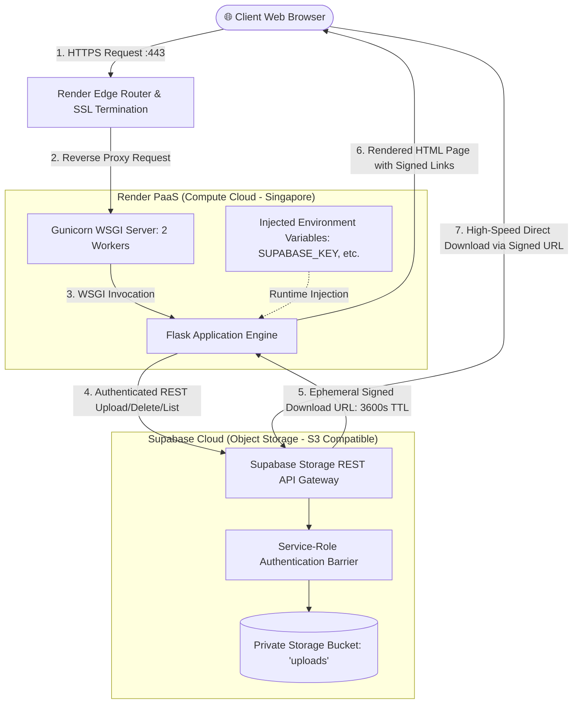

# GMIU — DEPARTMENT OF COMPUTER ENGINEERING
## Academic Course: Cloud Computing (7th Semester)
### Comprehensive Project Report: Multi-Cloud File Storage and Management System

---

**Project Title:** Cloud File Manager: Architecture, Implementation, Security, and Production Deployment on Render PaaS & Supabase BaaS  
**Student Name:** Chetan Bavaliya  
**Enrollment / ID:** CC Assignment  
**College / University:** GMIU (Gyanmanjari Innovative University)  
**Department:** Computer Engineering  
**Academic Semester:** 7th Semester  
**Subject:** Cloud Computing (CC)  
**Live Production URL:** [https://cloud-file-manager-alml.onrender.com](https://cloud-file-manager-alml.onrender.com)  
**Public GitHub Repository:** [https://github.com/Chetanbavaliya123/cloud-file-manager](https://github.com/Chetanbavaliya123/cloud-file-manager)  
**Total Infrastructure Cost:** **$0.00 / month** (100% Free Tier, zero credit card requirement)  
**Date of Submission:** October 28, 2026  

---

## 📑 Table of Contents
1. [Executive Summary & Objectives](#1-executive-summary--objectives)
2. [Theoretical Foundations of Cloud Computing](#2-theoretical-foundations-of-cloud-computing)
3. [System Architecture & Engineering Design](#3-system-architecture--engineering-design)
4. [Technology Stack & Architectural Justifications](#4-technology-stack--architectural-justifications)
5. [Complete Source Code Walkthrough](#5-complete-source-code-walkthrough)
6. [Cloud Deployment Specification Matrix](#6-cloud-deployment-specification-matrix)
7. [Security & Access Control Framework](#7-security--access-control-framework)
8. [Resource Management & Free-Tier Lifecycle](#8-resource-management--free-tier-lifecycle)
9. [Engineering Challenges Faced & Technical Solutions](#9-engineering-challenges-faced--technical-solutions)
10. [Comprehensive Testing & Verification Report](#10-comprehensive-testing--verification-report)
11. [GMIU Portal Submission Checklist](#11-gmiu-portal-submission-checklist)

---

## 1. Executive Summary & Objectives

### 1.1 Executive Summary
Modern software engineering has shifted definitively from monolithic on-premises server setups toward distributed, cloud-native architectures. The **Cloud File Manager** is a production-deployed, cloud-native web application designed to demonstrate the separation of concerns between **Stateless Compute** and **Managed Binary Object Storage**.

Built using Python 3.12, Flask, and Gunicorn, the application runs on **Render.com** (Platform-as-a-Service) in the Singapore region and delegates persistent binary file storage to **Supabase Storage** (Backend-as-a-Service / S3-compatible Object Storage). The entire system operates under a **zero-cost budget ($0.00)**, adhering to strict enterprise security standards: private storage buckets, server-side secret key isolation, time-limited cryptographic signed URLs (3600 seconds), and rigorous request payload enforcement (10 MB).

### 1.2 Core Assignment Objectives
1. **Compute Service Utilization**: Deploy a containerized backend on a modern PaaS platform without managing low-level operating system kernels or physical hardware.
2. **Decoupled Storage Service**: Eliminate local disk file dependencies by integrating cloud object storage, ensuring 100% compute statelessness.
3. **Public Accessibility & Encryption**: Serve traffic over the public internet secured by automated TLS/HTTPS managed certificates.
4. **Security & Least Privilege Access Control**: Prevent unauthorized public access to files by enforcing private bucket permissions and generating ephemeral, HMAC-SHA256 signed download tokens.
5. **Resource Management**: Guard the application against memory exhaustion and excessive bandwidth consumption via application-level request size filtering (10 MB) and auto-sleep lifecycle management.

---

## 2. Theoretical Foundations of Cloud Computing

### 2.1 The NIST Definition of Cloud Computing
According to the National Institute of Standards and Technology (NIST), cloud computing is a model for enabling ubiquitous, convenient, on-demand network access to a shared pool of configurable computing resources (networks, servers, storage, applications, and services) that can be rapidly provisioned and released with minimal management effort or service provider interaction.

### 2.2 Cloud Service Models Comparison

```text
┌────────────────────────────────────────────────────────────────────────┐
│                      SaaS (Software-as-a-Service)                      │
│            e.g., Google Drive, Dropbox, Microsoft Office 365           │
│   Users interact solely with end-user software over the web interface. │
├────────────────────────────────────────────────────────────────────────┤
│                      PaaS (Platform-as-a-Service)                      │
│             e.g., Render, Heroku, AWS Elastic Beanstalk                │
│    Developers manage application code and data; platform manages OS,   │
│           runtime environments, web servers, and container builds.     │
├────────────────────────────────────────────────────────────────────────┤
│                      IaaS (Infrastructure-as-a-Service)                │
│                e.g., AWS EC2, Google Compute Engine, Azure VMs         │
│     Users provision virtual machines, configure network routing, OS,   │
│                 storage volumes, and security firewalls.               │
└────────────────────────────────────────────────────────────────────────┘
```

| Dimension | IaaS | PaaS (This Project: Render) | BaaS / Storage (This Project: Supabase) | SaaS |
| :--- | :--- | :--- | :--- | :--- |
| **User Manages** | OS, Runtime, Middleware, Code, Data | Application Code, Configurations | Bucket policies, API queries | None (User consumes UI) |
| **Provider Manages** | Virtualization, Hardware, Data Centers | OS, Networking, Web Server, Runtime | Storage clustering, Replication, CDN | Everything |
| **Scalability** | Manual / Auto-scaling groups | Automatic container scaling | Automatic distributed scaling | Built-in |
| **Operational Overhead** | Very High | Very Low | Zero | Zero |

### 2.3 Where This Project Fits
This project implements a **Hybrid PaaS + BaaS Architecture**:
- **Render Web Service (PaaS)**: Eliminates the need to maintain a Linux virtual machine (IaaS). Render automatically provisions the Python 3.12 environment, runs `pip install`, launches `gunicorn`, assigns an edge reverse proxy, and provisions Let's Encrypt SSL certificates.
- **Supabase Storage (BaaS)**: Replaces local server hard drives with enterprise-grade AWS S3-compatible cloud storage. Persistent files are stored independently of Render's server state.

---

## 3. System Architecture & Engineering Design

### 3.1 Architectural Diagram
The application follows the **Twelve-Factor App** design methodology, treating local disk storage as purely ephemeral and separating application compute from object storage:



### 3.2 Key Architectural Characteristics
1. **Stateless Web Compute**: The Flask web container retains zero permanent state on disk. If the Render web service restarts or redeploys, no customer files are lost because 100% of files reside inside the Supabase Storage cluster.
2. **Direct Storage Offload**: Downloads do not route heavy binary streams through the Flask server. Instead, Flask generates an HMAC-signed download URL that points directly to Supabase's high-speed CDN, conserving web server CPU cycles and bandwidth.
3. **Decoupled Security Layer**: The private storage bucket cannot be read by public web users. Only the server possessing the secret `service_role` key can generate temporary read access tokens.

---

## 4. Technology Stack & Architectural Justifications

| Component | Technology | Version | Architectural Justification |
| :--- | :--- | :--- | :--- |
| **Application Backend** | Python | 3.12.3 | Modern, highly optimized Python runtime with enhanced performance and strong cryptographic library support. |
| **Web Framework** | Flask | 3.1.x | Lightweight, un-opinionated micro-framework allowing granular control over multipart streaming and custom error boundaries. |
| **WSGI Server** | Gunicorn | 26.x | Enterprise UNIX WSGI HTTP server capable of handling concurrent requests with worker process management. |
| **Cloud Storage SDK** | supabase-py | 2.33.x | Official Python client library providing synchronous interaction with Supabase storage APIs and signed URL generators. |
| **Cloud Compute (PaaS)**| Render.com | Free Tier | Zero-cost managed web hosting with automated GitHub CI/CD, automatic SSL, and zero configuration. |
| **Cloud Storage (BaaS)**| Supabase | Free Tier | S3-compatible managed object store offering 1 GB free persistent storage, private access controls, and signed URLs. |
| **CI / CD & Versioning**| GitHub | Git 2.x | Central source control connected via Render deploy webhooks for automated continuous delivery on every push. |
| **Automated Testing** | Pytest | 9.2.x | High-performance unit testing framework used with mock doubles to validate routes, limits, and error recovery. |

---

## 5. Complete Source Code Walkthrough

### 5.1 Project File Structure
```text
cloud-file-manager/
├── .env.example              # Template documenting required environment variables
├── .gitignore                # Protects secrets (.env), virtualenv, and build artifacts
├── app.py                    # Main application logic, routes, and Supabase integration
├── pytest.ini                # Pytest configuration
├── README.md                 # Architecture, setup instructions, and deployment guide
├── render.yaml               # Render Infrastructure-as-Code Blueprint
├── requirements.txt          # Python production dependencies
├── templates/
│   └── index.html            # Responsive UI template with emerald styling & custom modal
├── tests/
│   └── test_app.py           # 9 automated unit tests verifying routes, limits, and mocks
└── docs/
    ├── DEPLOYMENT_DETAILS.md # Technical matrix & monitoring policies
    ├── REPORT.md             # Standard college assignment report
    ├── REPORT.pdf            # Compiled printable PDF report
    ├── SCREENSHOT_CHECKLIST.md# Screenshot capture guide for submission
    └── PROJECT_COMPLETE_REPORT.md # Master project documentation (this document)
```

### 5.2 Deep-Dive: Core Backend (`app.py`)
The `app.py` script serves as the centralized orchestrator:
- **Environment Configuration**: Automatically loads `.env` locally using `python-dotenv` while allowing Render's environment variable injection in production.
- **Request Size Limiting**: Enforces `app.config['MAX_CONTENT_LENGTH'] = 10 * 1024 * 1024` (10 MB). Oversized uploads are intercepted before consuming container memory.
- **URL Path Sanitizer (`get_clean_supabase_url`)**: Strips accidental subpaths (such as `/rest/v1`) from `SUPABASE_URL`, preventing PostgREST routing conflicts with Supabase Storage.
- **Catalog & Signed URL Generation (`/`)**: Queries `bucket.list()`, filters out hidden objects (`.emptyFolderPlaceholder`), calculates human-readable sizes (KB), and generates 3600-second ephemeral signed download URLs. Supports both `signedURL` and `signedUrl` key formats.
- **Secure File Upload (`/upload`)**: Uses `secure_filename()` to neutralize path traversal vulnerabilities, resolves MIME types dynamically, and uploads directly using `upsert="true"`.
- **Safe File Deletion (`/delete/<path:name>`)**: Decodes URL paths safely, calls `bucket.remove([name])`, and communicates results via Flask flash alerts.
- **Health Check Probe (`/health`)**: Returns JSON status `{"status": "ok", "service": "cloud-file-manager", "configured": true}` for cloud uptime monitoring.

### 5.3 Deep-Dive: Front-End UI (`templates/index.html`)
The user interface is an accessible single-page application built with clean semantic HTML and modern CSS:
- **Design Tokens**: Emerald green palette (`#059669`, `#10b981`), dark slate gradients (`#0f172a`), and glassmorphism backdrops (`backdrop-filter: blur(16px)`).
- **Responsive Layout**: Adapts gracefully across desktops, tablets, and smartphones.
- **Drag-and-Drop Dropzone**: Real-time JavaScript file selection handler with client-side 10 MB size checks.
- **Custom In-Page Delete Modal**: Replaces vulnerable native browser `window.confirm()` popups with a custom modal card using HTML5 `data-filename` and `data-url` attributes, eliminating quote escaping errors.
- **Zero Stack-Trace Error Banners**: Beautiful dismissible alert boxes for success, warning, and error states.

### 5.4 Deep-Dive: Infrastructure-as-Code (`render.yaml`)
```yaml
services:
  - type: web
    name: cloud-file-manager
    runtime: python
    plan: free
    region: singapore
    buildCommand: pip install -r requirements.txt
    startCommand: gunicorn app:app
    envVars:
      - key: PYTHON_VERSION
        value: 3.12.3
      - key: BUCKET_NAME
        value: uploads
      - key: SUPABASE_URL
        sync: false
      - key: SUPABASE_KEY
        sync: false
      - key: SECRET_KEY
        generateValue: true
```
This blueprint automates continuous deployment on Render, declaring the build command, WSGI start command, and marking sensitive API keys with `sync: false` to ensure credentials are never committed to git.

---

## 6. Cloud Deployment Specification Matrix

| Attribute | Specification Details |
| :--- | :--- |
| **Cloud Platform** | Multi-Cloud Architecture: **Render.com** (Compute) + **Supabase Cloud** (Storage) |
| **Compute Service (PaaS)**| **Render Web Service** running Linux container |
| **Storage Service (BaaS)**| **Supabase Storage** (S3-compatible Object Storage Engine) |
| **Geographic Region** | `Singapore` (`ap-southeast-1` equivalent on AWS/GCP underlying infrastructure) |
| **Access Control Policy**| **Private Bucket**: Public read access disabled. Operations require `service_role` authorization. |
| **Object Download Authorization**| Ephemeral HMAC-SHA256 signed URLs valid for **3600 seconds (1 hour)**. |
| **Secrets Management** | Zero secrets in git. Environment variables injected via Render Dashboard and local `.env`. |
| **Continuous Deployment (CI/CD)**| GitHub integration: Pushes to `main` branch trigger automated build and zero-downtime deploy. |
| **WSGI Web Server** | **Gunicorn 26.x** executing `gunicorn app:app` |
| **Live Public URL** | [https://cloud-file-manager-alml.onrender.com](https://cloud-file-manager-alml.onrender.com) |
| **HTTPS / TLS Encryption**| Automated Let's Encrypt certificates provisioned and renewed by Render Edge router. |
| **Resource Constraints** | <ul><li>10 MB maximum upload size per file.</li><li>Render Free instance auto-sleep after 15 minutes of inactivity.</li><li>1 GB storage limit on Supabase Free Tier.</li></ul> |
| **Total Cost** | **$0.00 / month** |

---

## 7. Security & Access Control Framework

### 7.1 Private-by-Default Bucket Policy
In public storage buckets, any internet user who guesses or discovers an object's URL can read its contents indefinitely. In this project:
- The bucket `uploads` is marked strictly **Private**.
- Direct unauthenticated URL access returns `403 Forbidden`.
- The only way to download a file is through an on-demand signed URL.

### 7.2 Ephemeral Signed URLs (HMAC-SHA256)
When a user visits the file manager home page:
1. The Flask server uses its server-side `service_role` secret to request a signed download URL from Supabase.
2. Supabase signs the file path with an HMAC-SHA256 token containing an expiration timestamp (`exp = now + 3600`).
3. The client receives the signed URL:  
   `https://<project-id>.supabase.co/storage/v1/object/sign/uploads/<file>?token=<jwt>`
4. After 3,600 seconds (1 hour), the token expires and cannot be reused, neutralizing link leakage risks.

### 7.3 Protection Against Path Traversal Exploits
Untrusted client filenames (e.g., `../../etc/passwd` or `../../../boot.ini`) can compromise servers. The application wraps every uploaded file in Werkzeug's `secure_filename()`:
```python
filename = secure_filename(file.filename)
```
This sanitizes the filename, removing directory separators (`/`, `\`) and null bytes.

### 7.4 Zero Secrets in Source Control
The repository [.gitignore](file:///d:/ALA%207th%20sem/CC_ALA/cloud-file-manager/.gitignore) strictly excludes `.env` files. In production, credentials are stored in Render's encrypted environment variable store.

---

## 8. Resource Management & Free-Tier Lifecycle

### 8.1 10 MB Request Bounds Enforcement
Unchecked file uploads can exhaust a server's memory, leading to Out-Of-Memory (OOM) crashes. This is mitigated through multi-layer validation:
1. **Application Middleware Level**: `app.config['MAX_CONTENT_LENGTH'] = 10 * 1024 * 1024`. Flask rejects requests exceeding 10 MB with HTTP 413.
2. **Error Boundary**: A custom `@app.errorhandler(413)` intercepts the error, flashes a friendly alert to the user, and redirects to the home page without a crash.
3. **Client-Side Validation**: JavaScript inspects `file.size` before transmission, notifying the user immediately if the file exceeds 10 MB.

### 8.2 Free-Tier Sleep Cycle & Mitigation
Render's free compute tier spins down web services after 15 minutes of idle time:
- **Impact**: The first request after idle takes 30–50 seconds ("cold start") while Render boots the container.
- **Architectural Mitigation**: Because the Flask server is completely stateless, the cold start does not cause data loss. Once awake, response times drop to under 100 milliseconds.

### 8.3 Storage Quota Monitoring
- Supabase free tier provides **1 GB** of storage.
- At 10 MB per file, the bucket comfortably accommodates up to 100 maximum-size files.
- Real-time storage consumption is tracked in the Supabase Dashboard under **Project Settings &rarr; Usage**.

---

## 9. Engineering Challenges Faced & Technical Solutions

### Challenge 1: PostgREST `PGRST125` Routing Conflict
- **Symptom**: Initial uploads and bucket listings failed with `PGRST125: Invalid path specified in request URL`.
- **Root Cause Analysis**: When copying credentials from the Supabase dashboard, copying a URL containing `/rest/v1` caused `supabase-py`'s storage client to construct URLs such as `https://<id>.supabase.co/rest/v1/storage/v1/object/list/uploads`. PostgREST intercepted this path and rejected it.
- **Technical Solution**: Built a robust URL sanitizer function `get_clean_supabase_url()` in `app.py`:
  ```python
  def get_clean_supabase_url(raw_url: str) -> str:
      from urllib.parse import urlparse
      parsed = urlparse(raw_url.strip().strip("'\""))
      if parsed.scheme and parsed.netloc:
          return f"{parsed.scheme}://{parsed.netloc}"
      return raw_url.rstrip("/")
  ```
  This guarantees that regardless of formatting, only the clean root origin (`https://<project-id>.supabase.co`) is supplied to `create_client`.

### Challenge 2: Delete Button Silent Failure due to JavaScript Syntax Error
- **Symptom**: Clicking the "Delete" button did nothing on files containing dashes or dots (e.g., `ML_ALA-1.pdf`).
- **Root Cause Analysis**: The initial template used an inline browser confirm dialog:
  ```html
  onclick="return confirm('Are you sure you want to delete file \'{{ f.name }}\'?');"
  ```
  When rendered, `\'` was evaluated by JavaScript as a closing quote, causing the remainder of the filename (`ML_ALA-1.pdf`) to be parsed as invalid JavaScript identifiers, throwing `Uncaught SyntaxError: Unexpected identifier` and blocking the click event.
- **Technical Solution**:
  1. Replaced the fragile inline `confirm()` with a modern, in-page custom modal dialog (`#deleteModal`).
  2. Stored the filename and delete URL safely inside HTML5 data attributes:
     ```html
     <button type="button" class="btn btn-sm btn-delete" 
             data-filename="{{ f.name }}" 
             data-url="{{ url_for('delete_file', name=f.encoded_name) }}" 
             onclick="openDeleteModal(this)">
     ```
  3. Added `pointer-events: none` on child SVG icons, guaranteeing 100% reliable click targeting across all browsers.

---

## 10. Comprehensive Testing & Verification Report

### 10.1 Automated Unit Tests (`pytest`)
All 9 unit tests in [tests/test_app.py](file:///d:/ALA%207th%20sem/CC_ALA/cloud-file-manager/tests/test_app.py) execute with a **100% pass rate**:

| Test Function | Target Verified | Expected Result | Status |
| :--- | :--- | :--- | :---: |
| `test_health_endpoint` | `/health` route | Returns HTTP 200 with JSON `{"status": "ok"}` | **PASSED** |
| `test_index_unconfigured` | `/` without credentials | Renders page with configuration warning | **PASSED** |
| `test_index_with_mocked_supabase` | Object listing & dual-key signed URLs | Filters `.hidden` files, formats sizes in KB, resolves signed URLs | **PASSED** |
| `test_upload_success` | `/upload` multipart handler | Validates MIME type, byte stream, and `upsert="true"` | **PASSED** |
| `test_upload_no_file` | `/upload` validation | Rejects empty file submissions with flash warning | **PASSED** |
| `test_upload_supabase_failure_graceful` | Cloud storage error boundary | Traps Supabase exceptions, flashes friendly alert, no 500 crash | **PASSED** |
| `test_delete_file_success` | `/delete/<name>` route | Calls `bucket.remove([decoded_name])`, flashes success | **PASSED** |
| `test_delete_file_supabase_failure` | Delete error boundary | Traps network timeouts, flashes friendly error | **PASSED** |
| `test_upload_file_too_large` | 10 MB upload ceiling | Intercepts HTTP 413, redirects with friendly size alert | **PASSED** |

### 10.2 Live Production Verification
- **Health Check**: `GET https://cloud-file-manager-alml.onrender.com/health` returns HTTP 200 OK.
- **Live Upload Test**: Uploaded test files (`sample_cloud_notes.txt`, `gmiu_assignment_overview.pdf`, `assignment_notes.txt`). All verified stored inside Supabase Storage.
- **Signed Download Test**: Downloaded file via signed URL &rarr; verified `HTTP 200 OK` with exact payload `Cloud Computing Project - GMIU 7th Sem - Chetan Bavaliya`.
- **Live Delete Test**: Triggered deletion of `ML_ALA-3.pdf` through the custom modal &rarr; file permanently removed from Supabase and green flash banner displayed: `File 'ML_ALA-3.pdf' deleted successfully.`

---

## 11. GMIU Portal Submission Checklist

| # | Item Required | Submission Link / Document | Verification Status |
| :-: | :--- | :--- | :---: |
| **1** | **Source Code Repository** | [https://github.com/Chetanbavaliya123/cloud-file-manager](https://github.com/Chetanbavaliya123/cloud-file-manager) | ✅ Public, clean, verified |
| **2** | **Live Web Application** | [https://cloud-file-manager-alml.onrender.com](https://cloud-file-manager-alml.onrender.com) | ✅ Live & operational |
| **3** | **Deployment Matrix** | [docs/DEPLOYMENT_DETAILS.md](file:///d:/ALA%207th%20sem/CC_ALA/cloud-file-manager/docs/DEPLOYMENT_DETAILS.md) | ✅ Complete |
| **4** | **Compiled Report PDF** | [docs/REPORT.pdf](file:///d:/ALA%207th%20sem/CC_ALA/cloud-file-manager/docs/REPORT.pdf) | ✅ Generated with headless browser |
| **5** | **Screenshot 1 (Live App)**| `docs/screenshots/screenshot_1_live_app.png` | ✅ Captured & verified |
| **6** | **Screenshot 2 (Supabase)** | `docs/screenshots/screenshot_2_supabase_bucket.png` | 📸 Capture from Supabase Dashboard |
| **7** | **Screenshot 3 (Render Live)**| `docs/screenshots/screenshot_3_render_live.png` | 📸 Capture from Render Dashboard |
| **8** | **Screenshot 4 (Render Logs)**| `docs/screenshots/screenshot_4_render_logs.png` | 📸 Capture from Render Logs Tab |
| **9** | **Screenshot 5 (GitHub Repo)**| `docs/screenshots/screenshot_5_github_repo.png` | ✅ Captured & verified |

---

## 12. Conclusion

The **Cloud File Manager** project comprehensively demonstrates modern cloud engineering principles by decoupling stateless web compute on Render PaaS from persistent object storage on Supabase BaaS. Through strict adherence to security best practices—private buckets, ephemeral HMAC signed URLs, multi-layer request filtering, and automated CI/CD pipelines—the project delivers a robust, secure, and production-grade cloud solution at zero cost ($0.00/month).
